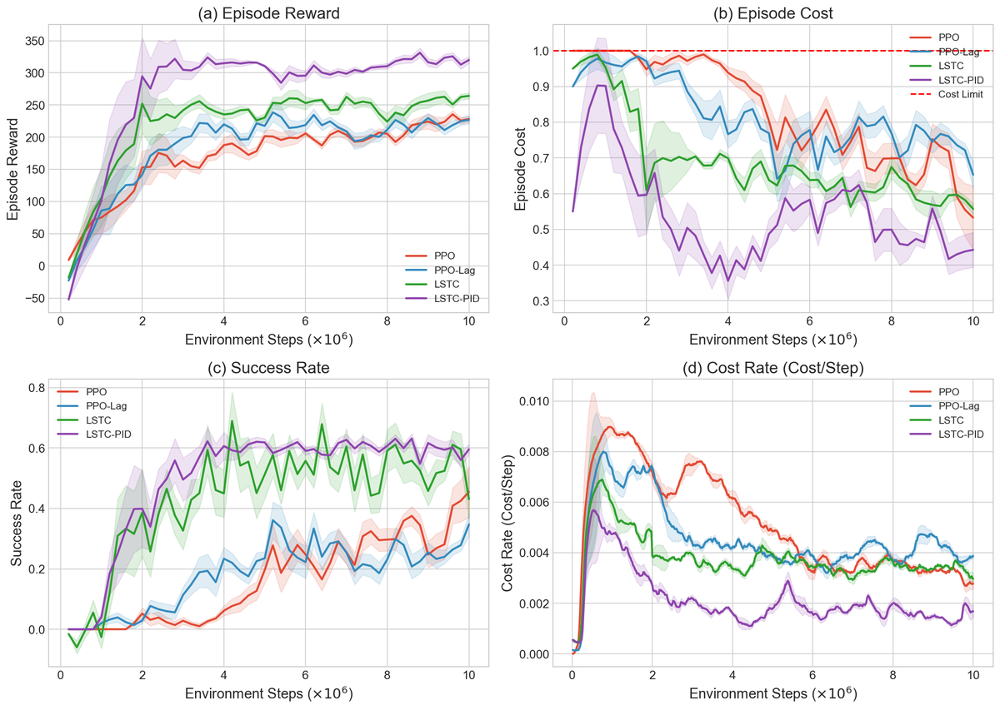
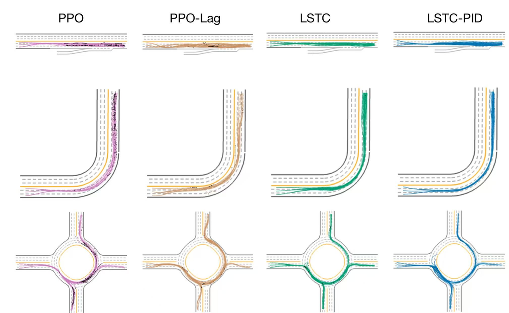

# SafeMeta-RL: Dual-Constraint Safe RL for Autonomous Driving

Safe reinforcement learning for urban driving in the MetaDrive *European Town* scenario,
posed as a constrained MDP with collision, off-road and traffic-rule costs. We compare four
increasingly safety-aware variants of PPO:

- **PPO**: reward-only baseline.
- **PPO-Lag**: PPO with long-term Lagrangian safety constraints.
- **LSTC**: long- and short-term constraints with trajectory-level action correction.
- **LSTC-PID (ours)**: LSTC whose Lagrange multipliers are updated by a PID controller instead
  of plain gradient ascent, which damps the oscillation of the dual variables.

Every method is trained for 10^7 environment steps on 20 generated town maps and evaluated on
20 held-out maps. The full write-up is in [docs/report.pdf](docs/report.pdf).

## Results

Success rate (higher is better) and episode cost (lower is better) on three representative
European Town scenarios:

| Method | Success InRamp | Success Slet | Success Rodab | Cost InRamp | Cost Slet | Cost Rodab |
|---|---|---|---|---|---|---|
| PPO | 98% | 78% | 36% | 3.1 | 3.7 | 4.7 |
| PPO-Lag | 98% | **100%** | 55% | 0.4 | 1.82 | 1.82 |
| LSTC | **100%** | **100%** | 73% | **0.2** | 0.56 | 0.88 |
| LSTC-PID (ours) | **100%** | **100%** | **78%** | 0.5 | **0.5** | **0.70** |

On the hardest scenario (roundabout), LSTC-PID more than doubles the success rate of PPO
while cutting its episode cost from 4.7 to 0.70.

<p align="center">
  
  
</p>

## Installation

Tested with Python 3.10+ on macOS (Apple Silicon) and Linux.

```bash
git clone https://github.com/WilliamQiuzy/SafeMeta-RL.git
cd SafeMeta-RL

# Create / activate your virtualenv first, then:
pip install -r requirements.txt
```

MetaDrive will be installed as part of the requirements; see the MetaDrive documentation if you
need GPU rendering or other advanced features.

## Training

All training scripts assume `PYTHONPATH=src` so that the `safemeta_rl` package is visible.

```bash
# PPO baseline
PYTHONPATH=src python scripts/train.py \
  --config configs/ppo.yaml \
  --output runs/ppo

# PPO-Lag baseline
PYTHONPATH=src python scripts/train.py \
  --config configs/ppo_lag.yaml \
  --output runs/ppo_lag

# LSTC (long/short-term constraints)
PYTHONPATH=src python scripts/train.py \
  --config configs/default.yaml \
  --output runs/lstc

# LSTC-PID (ours)
PYTHONPATH=src python scripts/train.py \
  --config configs/lstc_pid.yaml \
  --output runs/lstc_pid
```

Training uses `10^7` environment steps by default and may take several hours on a single machine.
You can reduce `total_env_steps` in the config files for quick sanity checks.

## Evaluation

The trained 10^7-step checkpoints of all four methods are attached to the
[v1.0 release](https://github.com/WilliamQiuzy/SafeMeta-RL/releases/tag/v1.0). Extract them at the
repository root, then rebuild the results table or export per-run metrics:

```bash
tar xzf safemeta-rl-checkpoints-10M.tar.gz     # creates runs/*/checkpoints/checkpoint_10000000.pt
PYTHONPATH=src python scripts/evaluate_table.py
PYTHONPATH=src python scripts/eval.py          # writes runs/*/metrics.csv
```

## Project Structure

```text
src/safemeta_rl/
├── agents/        # PPO, PPO-Lag, LSTC, LSTC-PID agents
├── envs/          # MetaDrive wrapper, reward and safety cost functions
├── networks/      # Policy, value, cost-value, validation networks
├── training/      # Trainer, rollout collection, logging
└── utils/         # Trajectories, replay buffer, loggers

configs/           # YAML configs for all algorithms
scripts/           # Training, evaluation and smoke tests
tests/             # Unit tests
docs/              # Report and figures
```

## Citation

```bibtex
@misc{qiu2025safemeta,
  author       = {Ziyue Qiu},
  title        = {Dual Constraints Safe Reinforcement Learning for Autonomous Driving},
  year         = {2025},
  note         = {Technical report},
  howpublished = {\url{https://github.com/WilliamQiuzy/SafeMeta-RL}}
}
```

Questions and feedback are welcome through GitHub issues.

## License

MIT, see [LICENSE](LICENSE).
